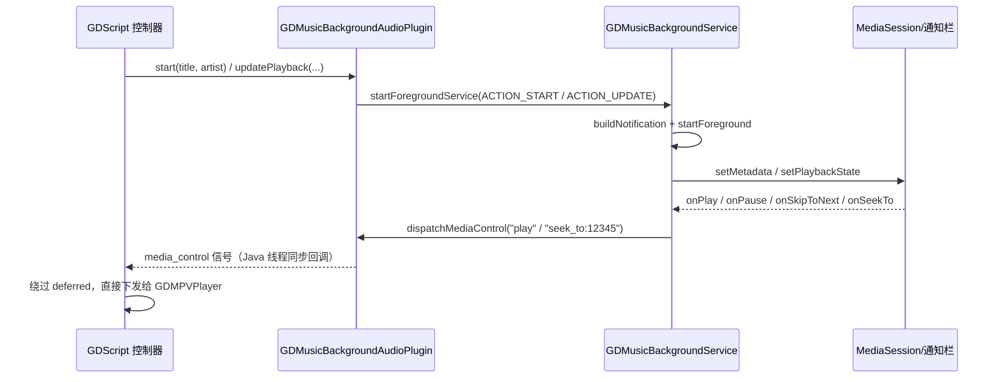

# Android 后台音频（功能实现文档）

| 项目 | 内容 |
| --- | --- |
| 文档日期 | 2026-10-27 |
| 最后更新 | 2026-10-27（合并 `2026-10-26` 旧材料后的校订版） |
| 对应代码版本 | develop @ 91d939d（工作区 2026-10-27） |
| 功能分类 | 播放内核 |
| 覆盖范围 | `android/plugins/GDMusicBackgroundAudio/`（`.gdap`、AAR、`AndroidManifest.xml`、两个 Java 源文件、`aar-build/` Gradle 工程）、`assets/scripts/ui/music_app/controllers/global/music_app_audio_controller.gd` 后台媒体控制分支、`export_presets.cfg` 插件开关 |

> 一句话定位：Godot 只管解码出声，Android 前台服务负责「不被杀 + 通知栏/锁屏可控 + 媒体键可响应」；两者通过一个 `media_control(String)` 信号和一组 Java 方法双向通信。

## 1. 功能概述

- **用户视角**：退出 App 或锁屏后音乐继续播；通知栏、锁屏、耳机线控能播/暂停/上下首；拖动通知栏进度条能跳转；通知卡片显示标题、歌手、封面。
- **实现视角**：Godot Android 插件 `GDMusicBackgroundAudioPlugin`（`JavaSingleton`，导出为 GDScript 单例 `GDMusicBackgroundAudio`）+ `GDMusicBackgroundService`（`Service`，持 `MediaSession`、`Notification`、`WakeLock`、音频焦点）；GDScript 侧全部逻辑收敛在 `MusicAppAudioController` 的后台媒体控制分支。
- **不在本期范围**：不做系统级「正在播放」库索引、不做音频可视化、不做 Android Auto；不接管通知栏的自定义布局（统一用 `Notification.MediaStyle`）。

## 2. 功能入口与调用链

| 入口 | 位置 | 说明 |
| --- | --- | --- |
| 插件注册声明 | `android/plugins/GDMusicBackgroundAudio.gdap` | `name` / `binary_type="local"` / `binary` 指向 AAR |
| Android 清单 | `android/plugins/GDMusicBackgroundAudio/AndroidManifest.xml:10` | `meta-data org.godotengine.plugin.v1.GDMusicBackgroundAudio` → `com.gdmusic.android.GDMusicBackgroundAudioPlugin` |
| 服务声明 | `android/plugins/GDMusicBackgroundAudio/AndroidManifest.xml:13` | `GDMusicBackgroundService`，`foregroundServiceType="mediaPlayback"`、`stopWithTask="false"` |
| 导出开关 | `export_presets.cfg:109` | `plugins/GDMusicBackgroundAudio=true` |
| GDScript 绑定 | `assets/scripts/ui/music_app/controllers/global/music_app_audio_controller.gd:107` | `bind_background_audio_controls()`，在 `assets/scripts/ui/music_app/music_app_showcase.gd:57` 的 `_ready` 中调用 |
| 状态回传 | `android/plugins/GDMusicBackgroundAudio/GDMusicBackgroundAudioPlugin.java:137` | `dispatchMediaControl()` → `emitSignal("media_control", action)` |



## 3. 核心数据结构

### 3.1 双向协议

**Java → GDScript（唯一信号）** `media_control(String)`，取值如下：

| action | 触发来源 | GDScript 处理 |
| --- | --- | --- |
| `play` / `pause` / `toggle` | 通知栏按钮、锁屏、耳机键 | `_on_background_media_control()`（`:116`）分支 |
| `next` / `previous` | 通知栏左右按钮 | `step_queue(±1, true)` 后同步换源 |
| `stop` | `MediaSession.Callback.onStop` | `stop_audio_playback(true)` 并清 `_loaded_track_key` |
| `seek_to:<毫秒>` | 锁屏/通知栏拖动进度条 | 换算成秒，同步 seek 并回推位置 |

**GDScript → Java（`@UsedByGodot` 方法）**：

| 方法 | 位置 | 作用 |
| --- | --- | --- |
| `start(title, artist)` | `android/plugins/GDMusicBackgroundAudio/GDMusicBackgroundAudioPlugin.java:43` | 拉起前台服务（先 start 再请求通知权限） |
| `updatePlayback(title, artist, positionSeconds, durationSeconds, playing)` | `:68` | 唯一的「常规状态推送」入口 |
| `updateMetadata(title, artist)` | `:62` | 内部转调 `updatePlayback(..., 0, 0, true)` |
| `updateArtwork(artworkBase64)` | `:85` | base64 JPEG 封面，空串表示清除旧图 |
| `pause()` / `resume()` / `stop()` | `:97` / `:102` / `:107` | 简单动作转发 |
| `requestNotificationPermission()` | `:116` | Android 13+ `POST_NOTIFICATIONS`，返回码 `7302` |
| `isAlive()`（静态） | `:132` | 服务侧判断插件实例是否还在 |

### 3.2 服务状态字段与常量

| 字段/常量 | 位置 | 含义 |
| --- | --- | --- |
| `NOTIFICATION_ID = 7301` | `android/plugins/GDMusicBackgroundAudio/GDMusicBackgroundService.java:56` | 固定通知 id，重复 `notify` 即更新同一张卡 |
| `CHANNEL_ID = "gdmusic_playback_v2"` | `:59` | 通道带版本后缀，用于覆盖旧 LOW 通道 |
| `WAKE_LOCK_TAG = "gd-music:BackgroundPlayback"` | `:60` | `PARTIAL_WAKE_LOCK` 标签 |
| `PLAYBACK_STATE_REFRESH_MS = 1000L` | `:62` | 播放中每秒重推 `PlaybackState` |
| `SKIP_THROTTLE_MS = 400L` | `:27` | `onSkipToNext` 去抖，防耳机键连击 |
| `title` / `artist` / `positionMillis` / `durationMillis` / `paused` / `artworkBitmap` | `:69`–`:74` | 服务内存态，进程内唯一真源 |
| `positionBaseMillis` / `positionBaseElapsedRealtime` | `:76`、`:77` | 外推基准「位置 + 基准时刻」，见 §4.4 |
| `EXTRA_POSITION_SECONDS` / `EXTRA_DURATION_SECONDS` | `:51`、`:52` | **单位是秒**，与 `Action` 里的毫秒换算 |

## 4. 关键实现

### 4.1 为什么用「前台服务 + 系统解码器仍在 Godot」

`android/plugins/GDMusicBackgroundAudio/GDMusicBackgroundService.java:25` 的类注释一句话点明：`Owns Android's background playback lifetime while Godot remains the decoder.`。App 切后台后 Godot 主循环会停滞，但音频线程/驱动仍在跑；系统只要还有前台服务，就不会把进程当缓存回收。因此服务**不碰解码**，只负责生命周期、通知、媒体会话、唤醒锁与音频焦点——避免「同一首歌两个解码器」。

### 4.2 通知栏按钮为什么要用 `getForegroundService`

这是本模块最大的坑，`createAction()`（`:419`–`:433`）里留了长注释：

```java
// ⚠ 必须用 getForegroundService：应用退到后台后，系统禁止后台进程
// 通过 startService 拉起新组件；getService 构造的 PendingIntent 会被静默丢弃，
// 表现为「点了暂停/下一首，通知栏图标变了但没有声音」。
pendingIntent = PendingIntent.getForegroundService(this, action.hashCode(), actionIntent, flags);
```

同时 `PendingIntent` 在 Android 12+ 必须带 `FLAG_IMMUTABLE`（`:421`），`action.hashCode()` 当 requestCode 保证不同按钮不互相覆盖。

这个坑的隐蔽性值得单独记一笔：`PendingIntent.getService()` 最终调的是 `Context.startService()`，而 Android 8 起后台进程就不允许 `startService` 拉起新组件（12 起更严），**系统对 `PendingIntent` 内部的失败不报错、不重试、不打日志**——logcat 里连 `onStartCommand` 都不会出现，只能看到「通知栏图标变了、声音没动」。所以这不是「偶发」而是「必然静默失败」，换 `getForegroundService()` 后一次修复。

### 4.3 Android 12+ 的 `startForegroundService` 时序

`_dispatch_background_action()`（`assets/scripts/ui/music_app/controllers/global/music_app_audio_controller.gd:1020`）的注释记录了线上现象：`startForegroundService` 发出后服务若没在时限内 `startForeground`，再来一次 `startForegroundService` 会让系统把 `ServiceRecord` 判死并抛 `RemoteServiceException(ForegroundServiceDidNotStartInTime)`。旧实现里 `start()`、`updatePlayback()`、`set_is_playing()` 各自都会唤起服务，一次点击触发三四次，必崩。

现行做法（`:1030`–`:1060`）：

- **所有常规状态推送统一收敛到 `updatePlayback()`**，只有会话初始化才走 `start()`；
- 用 `key = "title|artist|playing|duration"` 做 600ms 节流（`BACKGROUND_ACTION_MIN_INTERVAL_MSEC`，`:39`）；
- `stop` 也走节流：服务还没 `startForeground` 就被 stop，logcat 会出现 `Bringing down service while still waiting for start foreground`；
- `startForeground` 在 `onStartCommand` 里**先发通知再改 MediaSession**（`:170`–`:181`），保证期限约束优先满足。

### 4.4 进度外推与「拖动却不生效」

服务端不轮询 Godot，而是自己外推：`pushPlaybackState()`（`:476`）用 `positionBase + elapsed` 算当前位置，`speed` 在 1.0 / 0.0 间切；播放中 `scheduleProgressTicker()`（`:501`）每秒重推一次（`:86` 用 `postDelayed` 自调度），避免系统按速度外推漂移——`:470`–`:475` 的注释就是为小米 HyperOS 的媒体卡片/灵动岛进度条写的：只下发一次，几秒后进度就不动了。

坑在 GDScript 侧：`_push_background_seek_position()`（`:182`）注释说明，`seek_to:` 之后**不能**复用常规推送——常规推送的节流键不含位置，拖动中的位置会被节流丢掉，而服务会继续从旧基准外推，表现为「松手又跳回去」。所以 seek 分支直接调 `plugin.updatePlayback(...)` 并同步对齐 `_background_action_key` / `_background_action_at_msec`（`:197`）。

要让系统（尤其锁屏与通知栏那两个进度条）真的允许拖动，三件事缺一不可，任何一条不满足都表现为「进度条能拖但松手弹回」或「根本拖不动」：

| 必要条件 | 代码落点 | 不满足时的现象 |
| --- | --- | --- |
| `actions` 必须含 `ACTION_SEEK_TO` | `:447`、`:485`，两个构建点都要加 | 系统认为「此会话不支持 seek」，手指一碰就回弹 |
| 位置不能是 `PLAYBACK_POSITION_UNKNOWN`，且要持续刷新 | `PLAYBACK_STATE_REFRESH_MS = 1000L`（`:62`）+ `scheduleProgressTicker()`（`:501`） | 进度条停在原地或显示 `--:--` |
| 按「基准位置 + 基准时刻」外推，`updateTime` 用 `SystemClock.elapsedRealtime()` | `positionBaseMillis` / `positionBaseElapsedRealtime`（`:76`、`:77`）、`:496` | 用 `System.currentTimeMillis()` 作 `updateTime` 会让系统外推出错，位置乱跳 |

前两条对应「小米 HyperOS 对漂移特别敏感」那类问题时容易被误判成「系统不支持」，实际是 actions 或刷新缺失。

真机实测（Redmi 23113RKC6C / HyperOS 3，build 82 日志）：`dumpsys media_session` 里 `actions=823`（= PLAY|PAUSE|PLAY_PAUSE|SKIP_TO_NEXT|SKIP_TO_PREVIOUS|SEEK_TO|STOP 的位或），位置随时间推进 `8000 → 17000 → 33000` 毫秒，锁屏拖动后 `onSeekTo 246906` → 回读 `position=248000`，链路闭合。

App 内的播放页拖动是另一层，走的是「拖动中只预览、松手才 seek」的拆分（`_preview_progress_drag()` / `_seek_player_from_global_x()` + 350ms settle 窗口），见 [libmpv原生扩展](2026-10-27_libmpv原生扩展.md) §4.3；两处不是一回事：**App 内是 GDScript 直连播放器，后台是 Java MediaSession → 信号 → GDScript**，各有各的去重。

### 4.5 后台线程回调不能靠 `call_deferred`

`_on_background_media_control()`（`:116`）里那条 ⚠ 注释是核心设计约束：

> 这个回调是 Java 线程经由 `GodotPlugin.emitSignal` 同步调进来的，而 App 退到后台后 Godot 主循环基本不再推进，`request_audio_sync()` 里的 `call_deferred` 可能永远排不上队 —— 表现为「点了暂停/播放，通知栏图标变了但声音不动」。

因此后台媒体动作一律走三个 `_apply_immediate_*` 快路径：`_apply_immediate_seek`（`:166`）、`_apply_immediate_load`（`:202`）、`_apply_immediate_transport`（`:235`），直接对 `GDMPVPlayer` 下发同步命令（其内部有 mutex，允许跨线程调用，见 [libmpv原生扩展](2026-10-27_libmpv原生扩展.md) §4.2）。

`seek` 还有一处防「误判播完」：目标秒数被夹到 `duration - 1`（`:166` 起），否则精确 seek 到末尾会触发 `END_FILE`，歌单直接跳下一首。

### 4.6 音频焦点与唤醒锁

- 焦点：`initializeAudioFocus()`（`:211`）注册监听；`AUDIOFOCUS_LOSS` / `LOSS_TRANSIENT` 时 `paused = true` 并回传 `MEDIA_PAUSE`（`:216`），`AUDIOFOCUS_GAIN` 且原本未暂停则重新申请（`:224`）。Android 8+ 用 `AudioFocusRequest`（`:235`），低版本回退 `requestAudioFocus(listener, STREAM_MUSIC, GAIN)`（`:317`）。
- 唤醒锁：`PARTIAL_WAKE_LOCK` + 非引用计数（`:207`），只在实际播放时 `acquire()`，暂停/停止/`onDestroy` 都 `release()`（`:185` 的 `onDestroy` 顺序是 `removeCallbacks` → 释放焦点 → 释放锁 → 释放 MediaSession）。

### 4.7 通知与封面

- `buildNotification()`（`:346`）：`Notification.MediaStyle` + `setShowActionsInCompactView(0, 1, 2)`（`:399`），三个动作固定为上一首/播放暂停/下一首；`smallIcon` 用系统 `android.R.drawable.ic_media_play`（第三方插件不能带自定义 drawable 资源，直接用 App 资源会编译不过）；播放中 `ongoing=true`，`CATEGORY_TRANSPORT`、`VISIBILITY_PUBLIC`、Android 12+ `FOREGROUND_SERVICE_IMMEDIATE`。
- 通道：`createNotificationChannel()`（`:519`）用 `IMPORTANCE_DEFAULT`；`CHANNEL_ID` 带 `_v2` 后缀是因为通道重要性创建后不可提升，老用户已建的 LOW 通道收不到可见通知，只能换 id。
- 封面：`updateArtwork(base64)` → `decodeArtwork()` 解出 `Bitmap`，失败返回 `null`（不抛异常，保证「没封面也能出通知」）。GDScript 侧 `_push_notification_artwork()`（`:1238`）按「曲目 id + 图源」去重，空图源会显式发空串清掉上一首的图；`await` 解析完会**再次校验**当前曲目仍是同一首，避免慢网络下把旧封面贴到新歌上。
- `updateNotification()`（`:508`）捕获 `SecurityException`：Android 13 用户撤销通知权限后 `notify()` 会抛，不捕获会连带把服务搞挂。

### 4.8 构建：源码在插件目录，产物在 Gradle 工程

`aar-build/plugin/build.gradle` 的关键设计是**不把源码放进 Gradle 工程**：

```gradle
// 插件源码保持在 ../ 下，构建前复制到 build 目录，避免把 AAR 输出目录当成源码目录
def generatedPluginSources = file("$buildDir/generated/pluginSources")
tasks.register("syncPluginSources", Copy) {
    from("../../") { include("*.java") }
    into(generatedPluginSources)
}
```

`compileOnly` 依赖指向 `android/build/libs/debug/godot-lib.template_debug.aar`（Godot 导出 Android 时生成），`minSdk 24` / `compileSdk 36` / Java 17。产物 `GDMusicBackgroundAudio.aar`（约 14.3 KB，14,660 字节）由 `./gradlew :plugin:assembleDebug` 生成后替换到插件目录，再靠 `.gdap` 的 `binary` 字段被 Godot 打包。

### 4.9 为什么不用 PiP 小窗，也不用伪造焦点心跳

要理解这个模块为什么长成这样，得先看它替代了什么。Android 上引擎失焦会**主动停音频**：引擎在 `main_loop_focusout()` 里派发 `NOTIFICATION_APPLICATION_FOCUS_OUT` 之后调用音频驱动的 `set_pause(true)`（引擎源码 `platform/android/os_android.cpp`，不在本仓库），唯一例外是 PiP 小窗模式。所以在 mpv 之前，「退到后台继续播」只能靠两种绕法：

| 绕法 | 做法 | 为什么被弃用 |
| --- | --- | --- |
| 伪造焦点心跳 | 收到焦点丢失后每 2 秒补发一次伪造的「获得焦点」事件，把引擎状态掰回去 | 依赖引擎内部事件时序，通知栏下拉、分屏、系统弹窗任一变化就失效；伪造事件还会污染其他监听焦点状态的模块 |
| PiP 小窗 | 让 App 进画中画，使 `is_in_pip_mode()` 为真，引擎便不暂停 | 只能解 Android，iOS 无对应机制；纯音频进 PiP 需要用户额外授权，且必须一直盯着小窗 |

现在的分层是：mpv 后端不走 `AudioServer`，引擎暂停的是自己的音频驱动，对 mpv 无效；UI 侧则用 `PROCESS_MODE_ALWAYS`（`assets/scripts/ui/music_app/music_app_showcase.gd:51-52`，注释写明「Keep the audio pipeline processing while Android pauses the UI Activity」）让播放器节点在 Activity 暂停时继续被 `_process` 推进。于是「后台不断音」不再需要任何伪造或小窗技巧，只剩「别被系统杀」这一件纯 Android 的事——由前台服务负责。

## 5. 边界与失败处理

| 场景 | 行为 |
| --- | --- |
| 非 Android 平台 | `_get_background_audio_plugin()`（`:996`）直接返回 `null`，`bind_background_audio_controls()` 什么也不做 |
| AAR 未打进 APK | `Engine.get_singleton()` 返回 `null`，只 `push_warning`，播放本身不受影响 |
| Java 方法探测 | `_plugin_has_java_method()`（`:1006`）必须用 `has_java_method()`：`JNISingleton` 的 Java 方法不进 `ClassDB`，`has_method()` 恒为 false（见 `platform/android/api/jni_singleton.cpp`）；若引擎版本没有该 API 则乐观放行 |
| 后台起服务被拒 | `startServiceCompat()`（`android/plugins/GDMusicBackgroundAudio/GDMusicBackgroundAudioPlugin.java:151`）捕获 `IllegalStateException` / `SecurityException`，只打 logcat，Godot 侧继续播 |
| 通知权限被拒 | 通知不显示但服务正常；`requestNotificationPermission()` 只请求一次（`_notification_permission_requested` 守卫，`:1067`） |
| 同一状态重复推送 | 600ms 节流 + 键值比对，键不变直接 return |
| 耳机键连击下一首 | 服务侧 `SKIP_THROTTLE_MS = 400L` 去抖（`:274`） |
| 封面下载失败 | 服务保留无图通知，不阻塞状态推送 |
| 服务在 `onDestroy` 前崩溃 | `START_STICKY`，系统会重建服务；重建后靠下一次 `updatePlayback` 恢复元数据 |

## 6. 相关测试

无自动化测试（Android 插件需要真机 + 打包 APK 才能验证）。手工验证步骤：

1. 导出带 `plugins/GDMusicBackgroundAudio=true` 的 APK，播放一首在线歌曲；
2. 按 Home 键退后台 ≥30 秒，确认声音不断、通知卡片仍在；
3. 在通知栏依次点上一首/播放暂停/下一首，确认 UI 与声音同步；
4. 锁屏后拖动进度条，松手确认位置不回跳（验证 §4.4）；
5. 插拔耳机（或播放另一 App 的音频）验证音频焦点：外部播放应使本 App 暂停；
6. 熄屏待机 5 分钟，确认未被系统冻结（WakeLock 生效）；
7. 用 `adb logcat -s GDMusicBackgroundService GDMusicBackgroundAudioPlugin` 观察是否有 `ForegroundServiceDidNotStartInTime` 或 `Bringing down service` 告警。

> 沙箱环境不要直接跑 Godot 验证：沙箱内直接跑 Godot 会 `signal 11`（引擎无法创建 `~/Library/Application Support/Godot` user data 目录），需 `HOME=/tmp/godot-home` 绕过；本轮文档任务未运行 Godot。

### 6.1 真机验收记录

设备：Redmi 23113RKC6C / HyperOS 3，debug APK（build 82）。

| 验收项 | 结果 | 说明 |
| --- | --- | --- |
| Home 键退后台继续播放、无小窗 | ✅ | 对照组是改造前的 PiP 方案 |
| 息屏 31 分钟不断音 | ✅ | WakeLock + 前台服务生效 |
| 通知栏四个按钮 | ✅ | 上一首 / 播放暂停 / 下一首 / 停止 |
| 通知栏封面 | ✅ | `MediaMetaData{... art:valid}` |
| 通知栏进度条推进 | ✅ | 每秒推送，无停格 |
| 通知栏拖动进度 | ✅ | `onSeekTo 246906` → 回读 `position=248000` |
| 锁屏控制与曲目信息 | ✅ | 含灵动岛胶囊与展开态五项 |
| 本地文件内嵌封面 | ✅ | 4/4 命中 |
| m4a 首播起播 | ✅ | <1 秒 |
| 后台 30 分钟内存 | ✅ | 无异常增长 |
| 音量 | 🟡 | 控件与下发链路已验证，真机听感未确认 |
| 拔耳机自动暂停 | ⏳ | `adb` 无 `INJECT_EVENTS` 权限，未做成自动化 |

## 7. 相关文件清单

| 路径 | 作用 |
| --- | --- |
| `android/plugins/GDMusicBackgroundAudio.gdap` | Godot Android 插件描述（5 行） |
| `android/plugins/GDMusicBackgroundAudio/GDMusicBackgroundAudio.aar` | 打包产物（约 14.3 KB，14,660 字节） |
| `android/plugins/GDMusicBackgroundAudio/AndroidManifest.xml` | 权限、插件 meta-data、服务声明 |
| `android/plugins/GDMusicBackgroundAudio/GDMusicBackgroundAudioPlugin.java` | 插件入口、`@UsedByGodot` 方法、信号派发（172 行） |
| `android/plugins/GDMusicBackgroundAudio/GDMusicBackgroundService.java` | 前台服务、通知、MediaSession、焦点、WakeLock（540 行） |
| `android/plugins/GDMusicBackgroundAudio/aar-build/` | Gradle 工程（`:plugin` 子模块、wrapper 8.11.1、`local.properties`） |
| `android/plugins/GDMusicBackgroundAudio/aar-build/plugin/build.gradle` | AAR 构建脚本（47 行） |
| `assets/scripts/ui/music_app/controllers/global/music_app_audio_controller.gd` | GDScript 协议对端（`:107` 绑定、`:116` 回调、`:1020` 节流派发、`:1238` 封面） |
| `assets/scripts/ui/music_app/music_app_showcase.gd` | `:57` 调用 `bind_background_audio_controls()` |
| `export_presets.cfg` | `:109` 插件开关；`:106` `min_sdk=24`、`:107` `target_sdk=36`、仅 `arm64-v8a` |
| `docs/2026-10-27_libmpv原生扩展.md` | 后台音频依赖其跨线程调用能力（§4.2 线程模型） |

## 8. 已知限制与后续

- **任务描述与实际文件不符**：后台媒体控制代码在 `music_app_audio_controller.gd`，不存在 `music_app_playback_state_controller.gd`；`assets/scripts/ui/music_app/music_app_showcase.gd:57` 里变量名仍叫 `_playback_state_controller`，是历史命名。本文以真实代码为准。
- **只支持 arm64-v8a**：`export_presets.cfg` 未开 x86_64，模拟器上插件与 libmpv 都不会工作。
- **进度条依赖 1 秒推送**：`PLAYBACK_STATE_REFRESH_MS` 是功耗与观感的折中；进一步可改成只在 seek/暂停时推、其余交给 `speed` 外推，但小米系 ROM 会漂移，暂不采用（推断）。
- **通知栏自绘布局未做**：`RemoteViews` 自定义外观可以更接近主流播放器，但需要额外资源与兼容性测试。
- **无自动化测试**：服务逻辑只能靠真机回归；未来可考虑 `androidTest` 覆盖 `onStartCommand` 的分支与节流。
- **两项验收未闭环**：音量只有「控件与下发链路已验证」的结论，真机听感未确认；拔耳机自动暂停因为 `adb` 拿不到 `INJECT_EVENTS` 权限，一直是手工项。
- **iOS 完全空白**：本篇只覆盖 Android。iOS 的同等功能要靠 `AVAudioSessionCategoryPlayback` + `UIBackgroundModes: audio`，没有前台服务也没有 MediaSession，控制中心走 `MPNowPlayingInfoCenter`（详见 [libmpv原生扩展](2026-10-27_libmpv原生扩展.md) §8）。
- **节流键不含位置是有意为之**：常规推送 600ms 节流键是 `title|artist|playing|duration`，拖动进度时必须绕开（§4.4）；后续若给节流加位置字段，反而会把「拖动中的高频位置」全部放行，把服务打满——不要「顺手修」。
