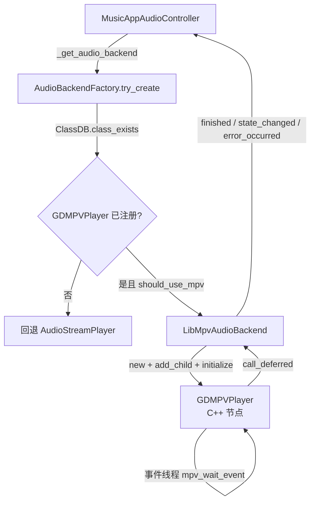

# libmpv 原生扩展（功能实现文档）

| 项目 | 内容 |
| --- | --- |
| 文档日期 | 2026-10-27 |
| 最后更新 | 2026-10-27（合并 `2026-10-26` 旧材料后的校订版） |
| 对应代码版本 | develop @ 91d939d（工作区 2026-10-27） |
| 功能分类 | 播放内核 |
| 覆盖范围 | `addons/gdmpv/`（GDExtension 描述、`src/`、`bin/`、`SConstruct`、`tools/`、`test/`）、`assets/scripts/ui/music_app/audio/`（后端抽象与工厂）、`assets/scripts/ui/music_app/controllers/global/music_app_audio_controller.gd`（接入点） |

> 一句话定位：用 libmpv 替换 Godot 原生解码，让移动端能直接播网络流式的 FLAC/OGG/AAC 等格式；桌面端默认仍走原生播放器，扩展不可用时全链路静默回退。

## 1. 功能概述

- **用户视角**：Android 上点一首在线歌曲可以直接出声（原生 `AudioStreamPlayer` 不解 AAC/FLAC 网络流），拖动进度条即时响应，锁屏/通知栏也能控。
- **实现视角**：`GDMPVPlayer`（C++ GDExtension，注册为全局类 `GDMPVPlayer`）→ `LibMpvAudioBackend`（GDScript 适配器，实现 `AudioBackend` 鸭子接口）→ `AudioBackendFactory`（选择策略）→ `MusicAppAudioController`（唯一接入点）。
- **不在本期范围**：不做视频输出（`vo=null`、`vid=no`）；不做 DSP/均衡器；不做音效/EQ/频谱可视化（mpv 不接管 Godot `AudioServer`）；不重写下载器、曲库与插件体系；不迁移 Web 端（Web 保持原生播放路径）。Windows/Linux 只有构建脚本，`bin/` 里没有对应产物。

**背景：为什么必须换掉引擎的音频驱动。** 这不是「换一个更好听的解码器」，而是绕开两个平台级根因：

| 平台 | 改造前的问题 | 根因 | 脚本层能否根治 |
| --- | --- | --- | --- |
| Windows / macOS / Linux | 本来正常 | 桌面端没有「失焦暂停音频」逻辑（`dx/dx.gd:131` 失焦只 `_broadcast_focus(false)` → `in_focus(false)` 仅发事件+打日志） | 不需要 |
| Android | 切后台/息屏后声音断，靠伪造 `focusin()` 心跳与 PiP 小窗续命 | `platform/android/os_android.cpp` 的 `OS_Android::main_loop_focusout()` 在派发 `NOTIFICATION_APPLICATION_FOCUS_OUT` 后调用 `audio_driver_android.set_pause(!dsa->is_in_pip_mode())` —— **失焦且不在画中画就把整个 OpenSL 音频驱动暂停** | 不能，是引擎行为 |
| iOS | 没有 iOS 端 | `drivers/coreaudio/audio_driver_coreaudio.mm` 未设置 `AVAudioSession` 类别（只读 `sampleRate`），默认落在 `SoloAmbient`，切后台即停；且 GDScript 摸不到 `AVAudioSession` | 不能，必须有一小段原生代码 |

三条可选出路（伪造 focusin 心跳 / 进 PiP / 改引擎源码）分别对应「脆弱」「用户体验差」「破坏 4.7 引擎」；本方案选第四条——**不再使用引擎的音频驱动**。这也解释了为什么它要长成 GDExtension：mpv 在自己的 native 线程解码输出，引擎那句 `set_pause(true)` 对它无效，于是 PiP 兜底、focusin 心跳、播放位置停滞探针全部成了可以删掉的债（已删，见 §8）。

## 2. 功能入口与调用链

| 入口 | 位置 | 说明 |
| --- | --- | --- |
| 扩展声明 | `addons/gdmpv/gdmpv.gdextension:25` | `entry_symbol = "gdmpv_init"`、`compatibility_minimum = "4.7"` |
| 入口符号实现 | `addons/gdmpv/src/register_types.cpp:22` | `gdmpv_init(...)`，最小初始化级别 `MODULE_INITIALIZATION_LEVEL_SCENE` |
| 类注册 | `addons/gdmpv/src/register_types.cpp:12` | `GDREGISTER_CLASS(GDMPVPlayer)` |
| 工厂探测 | `assets/scripts/ui/music_app/audio/audio_backend_factory.gd:19` | `ClassDB.class_exists("GDMPVPlayer")` |
| 创建后端 | `assets/scripts/ui/music_app/audio/audio_backend_factory.gd:34` | `try_create(host)`，失败返回 `null` |
| 控制器接入 | `assets/scripts/ui/music_app/controllers/global/music_app_audio_controller.gd:1127` | `_get_audio_backend()`，懒创建并只探测一次 |
| 流式播放路径 | `assets/scripts/ui/music_app/controllers/global/music_app_audio_controller.gd:759` | `_sync_streaming_playback()`，走 `load_source(url, headers)` |



## 3. 核心数据结构

### 3.1 目录与产物

| 路径 | 作用 |
| --- | --- |
| `addons/gdmpv/gdmpv.gdextension` | 60 行：入口符号、平台/架构矩阵、`[dependencies]` 动态库清单 |
| `addons/gdmpv/src/gdmpv_player.h` | `GDMPVPlayer` 类声明（`mpv_handle* ctx`、事件线程、三个缓存锁） |
| `addons/gdmpv/src/gdmpv_player.cpp` | 全部 C API 调用与事件分发 |
| `addons/gdmpv/src/register_types.cpp` | 类注册 + 入口符号 |
| `addons/gdmpv/SConstruct` | 构建脚本（pkg-config / Android NDK 两套路径） |
| `addons/gdmpv/bin/libgdmpv.macos.template_debug.arm64.dylib` | macOS arm64 调试产物（当前 `bin/` 内唯一桌面产物） |
| `addons/gdmpv/bin/libgdmpv.android.template_debug.arm64.so` | Android arm64 主库 |
| `addons/gdmpv/bin/android_arm64/` | 9 个依赖库：`libmpv.so` + ffmpeg 6 件套 + `libc++_shared.so` |
| `addons/gdmpv/thirdparty/mpv-android` | Android 预编译 libmpv 前缀目录 |
| `addons/gdmpv/tools/build_android_libmpv.sh` | Android libmpv 交叉编译脚本 |
| `addons/gdmpv/vendor/godot-cpp` | godot-cpp 源码（`SConstruct:22` 可被 `GODOT_CPP_PATH` 覆盖） |

### 3.2 C++ 侧接口（`GDMPVPlayer extends Node`）

| 方法 | 实现的 mpv 动作 | 说明 |
| --- | --- | --- |
| `initialize()` | `mpv_create` + 选项 + `mpv_initialize` | 选项必须在 initialize 前设（`addons/gdmpv/src/gdmpv_player.cpp:57`） |
| `load_file(url, headers)` | `loadfile` 命令；headers → `http-header-fields` | `res://`/`user://` 先 `globalize_path`（`:263`，注释在 `:261`） |
| `play()` / `pause()` | `pause=no` / `pause=yes` | 不销毁实例，秒级响应（`:278`、`:291`） |
| `stop()` | `stop` 命令 | 保留实例（`:312`） |
| `seek(sec)` | `seek <sec> absolute+exact` | 精确模式（`:330`） |
| `get_position()` / `get_duration()` | 读缓存值（`time-pos` / `duration`） | 事件线程写入，失败为 `-1` |
| `set_volume(ratio)` | `volume = ratio*100` | 量纲换算（`:377`） |
| `shutdown()` | 停事件线程 → `mpv_terminate_destroy` | 顺序不能反（`:94`） |

### 3.3 GDScript 侧接口（`AudioBackend`）

| 成员 | 位置 | 与 `AudioStreamPlayer` 的关系 |
| --- | --- | --- |
| `signal finished` | `assets/scripts/ui/music_app/audio/audio_backend.gd:15` | 同名同语义，可直接接现有回调 |
| `signal state_changed(playing)` | `assets/scripts/ui/music_app/audio/audio_backend.gd:17` | mpv 后端额外提供 |
| `signal error_occurred(message)` | `assets/scripts/ui/music_app/audio/audio_backend.gd:19` | 原生路径不发射 |
| `stream` / `stream_paused` | `assets/scripts/ui/music_app/audio/audio_backend.gd:23`、`:30` | 伪装属性，让旧代码不感知后端差异 |
| `play/seek/stop/get_playback_position/get_duration/set_volume_db` | `assets/scripts/ui/music_app/audio/audio_backend.gd:53`–`:68` | 鸭子接口，逐项对齐 |
| `load_source(url, headers)` | `assets/scripts/ui/music_app/audio/libmpv_audio_backend.gd:62` | **只有流式后端有**，是控制器的判定依据 |

## 4. 关键实现

### 4.1 初始化参数：让 mpv 只做音频、不抢设备

`addons/gdmpv/src/gdmpv_player.cpp:58-67` 逐条设置，每一条都有明确意图（全部在 `mpv_initialize` 之前，`:69`）：

| 参数 | 值 | 为什么 |
| --- | --- | --- |
| `vo` / `vid` | `null` / `no` | 纯音频，省一次视频解码 |
| `audio-exclusive` | `no` | 与 Godot AudioServer 共享设备，否则会互相掐 |
| `audio-client-name` | `gd-music` | 系统混音器里显示应用名 |
| `cache` + `demuxer-max-bytes` + `demuxer-readahead-secs` | `yes` / `150MiB` / `30` | 网络流抗抖动，同时给内存设上限 |
| `idle` | `yes` | 无文件时不销毁实例，省掉反复创建 |
| `keep-open` | `no` | 播完即报 EOF，靠 `eof-reached` 做去重 |
| `msg-level` | `all=error` | 静默日志；需要排错时改 `mpv_request_log_messages` |

> 早期版本写的是 `really-quiet=yes`，现行代码已换成 `msg-level=all=error`（`:67`）——两者都压制日志，但后者能配合 `mpv_request_log_messages(ctx, "error")`（`:85`）保留错误级输出。排错时要**主动把日志放开**：`really-quiet` 下 `[gdmpv]` 前缀的 C++ 日志一条都看不到，只剩「切歌很快」这类表象；放开到 `msg-level=all=status,ao=info,audio=info,decoder=info` 才看得到 `end-file reason=2`（STOP）被误判成播放结束。
>
> 音频输出走哪个 AO、以及它与 Godot 音频驱动的共存关系，见 §4.6。

### 4.2 线程模型：主线程绝不阻塞

事件线程在 `initialize()` 末尾以 `std::thread(...).detach()` 起（`addons/gdmpv/src/gdmpv_player.cpp:88`），循环体是 `mpv_wait_event(ctx, 0.5)`（`:120`）——**绝不放在 Godot 主线程**，否则渲染直接卡死。

状态回传有两条硬约束：

1. 所有 `time-pos` / `duration` / `pause` / `eof-reached` / `paused-for-cache` 观察值先写进带 `std::mutex` 的缓存，GDScript 侧（经 `get_playback_position()`）只读缓存，不跨线程调 mpv；
2. 信号一律 `call_deferred("emit_signal", ...)`（`:217`、`:221`、`:225`），因为 `MessageQueue` 本身线程安全，而 `emit_signal` 不是。

退出顺序是踩过的坑：`shutdown()`（`:94`）先 `event_running.exchange(false)` → `mpv_wakeup` 唤醒阻塞的 `mpv_wait_event` → `sleep 30ms` 等线程自然退出 → 才 `mpv_terminate_destroy`。「退出时崩溃」的根因就是「事件线程未停就 destroy」，现行代码正是那条修复（排错表见 §5）。

事件与状态的同步原则是**单一事实来源在 native 侧**：GDScript 只读不推。

| 状态 | 来源 |
| --- | --- |
| 播放结束 | mpv `MPV_EVENT_END_FILE` → native 记录 → 主线程 `call_deferred` 发 `finished` |
| 暂停/恢复/缓冲 | `mpv_observe_property` 的五个观察点：`time-pos`(1)、`duration`(2)、`pause`(3)、`eof-reached`(4)、`paused-for-cache`(5)，见 `addons/gdmpv/src/gdmpv_player.cpp:77-81` |
| 位置/时长 | 事件线程写缓存，GDScript 读缓存（`get_playback_position()` / `get_duration()`），不跨线程调 mpv |

`mpv_observe_property` 之外没有别的轮询：位置由 `time-pos` 事件持续刷新，因此「每帧读一次 `time-pos`」在实现上是 O(1) 读本地 double，而不是跨线程 IPC。

### 4.3 seek 与 EOF 的去重

- `seek()` 用 `mpv_command_string("seek %.3f absolute+exact")`，选精确模式是因为 `keyframe` 模式在纯音频上会跳过头，用户体验是「拖到 3:00 实际从 2:58 开始」。
- `seek` 后位置缓存立即改写，避免通知栏短暂回跳；`addons/gdmpv/src/gdmpv_player.cpp:342` 有 `TODO(Phase 1)` 说明「标记 seeking 等 `MPV_EVENT_SEEK`」尚未实现，当前靠位置缓存掩盖。设计上仍要求「等 `MPV_EVENT_SEEK` 再回读」，实测（macOS 探针采样 10 次，`backjumps=0`）没有观察到回弹，所以这个守卫目前是廉价保险而非必需。
- `finished` 只发一次：靠 `cached_eof` 标记 + `MPV_EVENT_END_FILE`，而 `END_FILE` 的 `reason` 必须分类——只有 `EOF`/`ERROR` 才算播完，`STOP`（切歌、`stop()` 触发）必须复位全部标志。早期实现无条件置 `cached_eof=true`，结果一次切歌后 `is_playing()` 恒为 `false`；「`finished` 发射两次」也属同一类双触发问题。
- **App 内拖进度条**是另一层去重，且与 mpv 无关：`_input()` 若对每个 `InputEventScreenDrag` 都调 `seek_to_progress_ratio()`，一秒几十次 `absolute+exact` 会把主线程和 mpv 事件线程同时打满，表现为「进度条粘手」。现行把「拖动」与「跳转」拆开（`assets/scripts/ui/music_app/views/player/music_app_player_view.gd`）：

| 阶段 | 行为 |
| --- | --- |
| 按下 / 拖动中 | `_preview_progress_drag()`（`:910`）只改 `player_progress_bar.value` 与 `elapsed_label`，一次 seek 都不发 |
| 松手 | 才调一次 `_seek_player_from_global_x(x, true)`（`:897`）真正跳转 |
| 松手后 350 ms | `_progress_seek_settle_until_msec` 静默窗口（`:902`），`refresh()` 在 `:215-216` 跳过进度条与已播时间的赋值，避免 mpv 还没吐出新的 `time-pos` 时先弹回旧位置 |
| 每秒进度事件 | `_is_progress_dragging` 为真时整个跳过，否则手指会被「每秒回拉一次」 |

  判断依据很直接：拖拽全程的 `seek` 调用次数从「每个 drag 事件一次」降到「每次拖拽一次」。后台场景的同步 seek 另有一层约束（不能走 deferred），见 [Android后台音频](2026-10-27_Android后台音频.md) §4.5。


### 4.4 后端选择与回退

`audio_backend_factory.gd` 顶部注释把优先级写死了：项目设置强制 → 移动端自动 → 其余原生。实现上：

```gdscript
# audio_backend_factory.gd:24
static func should_use_mpv() -> bool:
	var forced: Variant = ProjectSettings.get_setting(SETTING_USE_MPV, null)
	if forced is bool:
		return forced
	return OS.get_name() in MOBILE_PLATFORMS
```

`project.godot` 里**没有** `audio/backend/use_mpv` 这一项（已核对），所以当前行为是：Android/iOS 自动启用 mpv，桌面端一律原生。`try_create()`（`:34`）在任何一步失败时都 `return null`，并且只有用户显式设了 `true` 才 `push_warning`——「静默回退」是刻意设计：扩展没编译时 App 仍要能播。

`LibMpvAudioBackend` 自身的失败也收敛成 `is_available()` + `get_init_error()`（`assets/scripts/ui/music_app/audio/libmpv_audio_backend.gd:51`、`:55`），工厂据此决定是否回退（`:47`）。

### 4.5 控制器如何无痛接入

`MusicAppAudioController` 用一次**鸭子类型探测**把两套后端统一起来，而不是 `if backend is LibMpvAudioBackend`：

```gdscript
# music_app_audio_controller.gd:755
func _is_streaming_backend(player) -> bool:
	return player != null and player.has_method("load_source")
```

这样 `FFmpegVideoStream` / 未来任何「能自己 load 源」的后端都能复用同一条分支。流式路径（`:759` 的 `_sync_streaming_playback`）与原生路径的差别只有两处：不把整首下载成 `AudioStream`（省内存，也避免长音频首帧等待）；时长在 `play()` 之后才可用，所以 `_sync_track_duration_from_backend()`（`:948`）在播放开始后补写 `track.duration`。

后端实例懒创建一次（`:1128` 的 `_audio_backend_probed`），创建时一次性接好 `finished` / `error_occurred`（`:1137`–`:1140`）；后端报错只记一条 `push_warning` 并计入熔断窗口（`_record_background_error()`），不会把播放队列打停。

#### 音量链路：两套后端共用同一个「线性音量」

清空点在于 mpv 与 `AudioStreamPlayer` 的音量单位不同，而 UI 只想存一个 0–1 的数：

| 环节 | 代码 | 说明 |
| --- | --- | --- |
| UI 入口 | `set_playback_volume()`（`:1386`） | `clampf(value, 0, 1)`，变化才下发 |
| 折算 | `_apply_playback_volume()`（`:1395`） | `linear_to_db(playback_volume)`，`> 0.001` 才取对数 |
| 静音 | `:1396` | 0 走固定 `-80.0` dB 而不是 `-inf`，避免后端收到非法值 |
| mpv 后端 | `:1400`–`:1402` → `assets/scripts/ui/music_app/audio/libmpv_audio_backend.gd:150-152` | `set_volume_db(db)` 内部 `db_to_linear(db)` 再调 `_player.set_volume(ratio)` |
| 原生后端 | `:1404`–`:1406` | 直接写 `AudioStreamPlayer.volume_db` |
| 持久化 | `PLAYBACK_SETTINGS_PATH`（`:63`，`user://music_app_settings.cfg`） | `[playback] volume`，默认 1.0（`:1419`），保存用 `:1425` |
| 首次应用 | `_ensure_playback_volume_applied()`（`:1408`） | 后端首次创建后（`:1141`）载入配置并下发，否则「上次的音量」要等用户再动一次滑块才生效 |

量纲要绕两圈，这是最容易写错的地方：UI 存线性 0–1 → controller 折成 dB（`:1396`）→ 后端 `set_volume_db()` 再 `db_to_linear()` 折回线性（`assets/scripts/ui/music_app/audio/libmpv_audio_backend.gd:152`）→ `GDMPVPlayer::set_volume(ratio)`（`addons/gdmpv/src/gdmpv_player.cpp:377`）clamp 后 ×100 写 mpv 的 `volume`（`:383`–`:384`）。

为什么不干脆让后端直接收线性值：`AudioBackend` 要同时适配 `AudioStreamPlayer`（只认 `volume_db`）与 mpv（只认 0–100），接口只能选一侧；选 dB 是因为原生后端是默认路径，少一次转换就少一处「0 音量变 -inf」的坑。

### 4.6 音频输出路径与 AudioServer 共存

mpv 走自己的 AO，不经过 Godot `AudioServer`，因此两个输出栈会同时占着设备。本项目**不显式设置 `ao`**（选项块里没有这一条），由 libmpv 按平台选默认 AO；下表的默认值是 mpv 的常规选择，只在排错时用 `ao=` 手动覆盖：

| 平台 | 默认 AO | 共存说明 |
| --- | --- | --- |
| Windows | `wasapi` | 共享模式，与 Godot 的 WASAPI 共存 |
| macOS | `coreaudio` | 多客户端天然共存 |
| Linux | `pulse`（可回调 `alsa`） | pulse 可共存；直连 ALSA 可能独占，需手动 `ao=alsa` 切换 |
| Android | `audiotrack`（备选 `aaudio`） | 与 Godot 的 OpenSL 混音共存 |
| iOS | `audiounit` | 需 `AVAudioSessionCategoryPlayback`（见 §8） |

真正起决定作用的开关是 `audio-exclusive=no`（`addons/gdmpv/src/gdmpv_player.cpp:60`）：它让 mpv 请求共享设备而不是独占。在 macOS 上已直接验证过「Godot 播 UI 音效的同时 mpv 播歌」不抢占设备。

若某平台确实冲突，兜底方案是**播放歌曲期间把 Godot 音频驱动切为 Dummy**（`AudioServer` 的 driver 设成 `Dummy`，或启动参数 `--audio-driver Dummy`），代价是 UI 音效静音——所以只作为兜底，不默认启用。

### 4.7 选型：为什么是 libmpv

| 维度 | **libmpv** | miniaudio | ExoPlayer（仅 Android） | 改引擎 |
| --- | --- | --- | --- | --- |
| 跨平台 | 五平台一套 | 五平台一套 | 仅 Android | 全平台（引擎级） |
| 格式覆盖 | 全格式 | mp3/wav/flac | 10+ 原生 | 取决于引擎 |
| 流式/缓存 | 自带 | 需自写 | 自带 | 引擎自带 |
| 通知栏/锁屏 | 需自做 | 需自做 | 免费 | 需自做 |
| 后台保活 | 仍需前台服务 | 仍需前台服务 | 服务自带 | 引擎内解决 |
| 包体积 | +15~25 MB | +1 MB | 小 | 0 |
| 工程量 | 1–2 周 | 3–5 天 | 3–4 天 | 1–2 小时（但每次升级重编） |
| 主要风险 | 三端构建流水线 | 重造半个播放器 | 只解决一端 | 维护补丁 |

选它的五条理由：

1. **唯一同时满足「一套核心 + 全格式 + 五平台」的选项**。项目诉求是跨平台一致性，不是单平台最优。
2. **格式与流式一次到位**：m4a 必须整首下载、FFmpeg 扩展平台缺失两类缺陷同时消失（当前「音频后端与解码」里的 FFmpeg 回退链路仍在，属桌面兜底，见 §8）。
3. **保活问题被解耦**：mpv 在独立 native 线程解码输出，不依赖 Godot 主循环；进后台可以停渲染、降主循环频率，只留 mpv + 前台服务，耗电与稳定性都优于「引擎整体在后台跑」。
4. **不碰引擎源码**：不产生补丁维护负担，Godot 升级不受影响。
5. **可渐进回退**：`AudioBackend` 接口保留原生实现，出问题一键切回（§4.4 的 `audio/backend/use_mpv=false`）。

代价也明码标价，写在这里以免后人误以为零成本：

- 包体积 +15~25 MB/架构（可裁剪解码器压到 8~15 MB，见 §8）；
- 需维护三套构建（桌面 / Android / iOS），iOS 交叉编译最重；
- 失去 Godot `AudioServer` 上的音频效果（EQ、总线、频谱）；
- 通知栏/锁屏/耳机键要自己实现（Android 复用现有 MediaSession，见 [Android后台音频](2026-10-27_Android后台音频.md)）；
- mpv 是 GPL/LGPL 双构建，必须按 LGPL 编译与分发（§4.9）。

### 4.8 接口契约与后端职责分工

`audio_backend.gd` 是**只有行为约定、没有实现**的抽象后端（成员逐项见 §3.3）。它对外承诺三类东西：

| 类别 | 内容 |
| --- | --- |
| 三个信号 | `finished`（`:15`）、`state_changed(playing)`（`:17`）、`error_occurred(message)`（`:19`） |
| 与播放器对齐的属性 | `stream`（`:23`，libmpv 后端不使用，只为兼容调用点）、`stream_paused`（`:30`，内部转调 `is_paused()` / `set_paused()`） |
| 子类必须实现 | `_get_stream` / `_set_stream`（`:38`/`:41`）、`is_playing()`（`:44`）、`is_paused()`（`:47`）、`set_paused()`（`:50`）、`play(from_position)`（`:53`）、`seek(seconds)`（`:56`）、`stop()`（`:59`）、`get_playback_position()`（`:62`）、`get_duration()`（`:65`）、`set_volume_db(db)`（`:68`）、`shutdown()`（`:71`） |
| 通用实现 | `has_stream()`（`:76`）、`is_available()`（`:80`，libmpv 未编译/未加载时返回 false，工厂据此回退） |
| 流式后端独有 | `load_source(url, headers)`（`assets/scripts/ui/music_app/audio/libmpv_audio_backend.gd:62`）——不在基类里，控制器靠 `has_method("load_source")` 判别 |
| 失败约定 | `load_source` 返回 `Error`；时长未知时返回 `-1` 而不是 `0` —— 上层据此区分「还没开始」和「在 0 秒处」 |

三处与最初设计不同、都是实现时撞出来的（以代码为准，勿按旧设计理解）：

- `load_source` 从「无返回值」改成返回 `Error`，controller 才能识别失败并回退，而不是静默无声；
- 补了 `is_paused()`：判「暂停中」与判「没在播」是两件事，`AudioStreamPlayer.stream_paused` 的语义需要单独暴露；
- 错误信号名是 `error_occurred(message: String)` 而不是 `error`：名字要能表达「发生了错误」这个事件，且避免与项目里把 `error` 当局部变量名的习惯撞车。

三个后端的分工（`assets/scripts/ui/music_app/audio/`，两条具体实现 + 一个抽象基类）：

| 后端 | 职责 | 适用 |
| --- | --- | --- |
| `audio_backend.gd`（`class_name AudioBackend`，`extends RefCounted`） | 纯接口，无实现；见上表 | 被下面两个实现共同继承 |
| `node_audio_backend.gd`（`class_name NodeAudioBackend`） | 把**现有 Godot 播放器节点**（`AudioStreamPlayer` / `VideoStreamPlayer`）包成 `AudioBackend`：行为与改造前一致，只是把 controller 里 `_player_is_paused` / `_player_position` / `_set_player_paused` 那几个手工分派函数收拢进来。**不接管节点生命周期**，由场景/controller 持有 | 桌面 / 扩展不可用时的兜底 |
| `libmpv_audio_backend.gd`（`class_name LibMpvAudioBackend`） | **直接 `extends AudioBackend`**（不继承 `NodeAudioBackend`），持有一个 `GDMPVPlayer`，`load_source` 直接把地址交给 mpv —— 不解码、不下载、不缓存 | Android / iOS / 手动开启的桌面 |

关键差别：原生路径是「controller 解码 → 塞流 → 播放」，mpv 路径是「controller 只给地址 → mpv 自己边下边解边播」，流式播放的来源就在这一句；也正因为不走 `AudioServer`，它才不受引擎「失焦暂停音频」影响。

### 4.9 许可证与合规

mpv 有两种构建，选错会直接堵死分发：

| 构建 | 效果 | 对 App 的约束 |
| --- | --- | --- |
| 默认 GPLv2+（`-Dgpl=true`） | libmpv 以 GPL 分发 | 整个应用必须 GPL 开源，无法上架 App Store |
| **LGPL（`-Dgpl=false`）** | libmpv 以 LGPLv2.1+ 分发 | 可闭源分发；动态链接需允许替换库，静态链接需提供重链接手段 |

**本项目必须用 `-Dgpl=false`（LGPL）构建 libmpv。** 注意 `brew install mpv` 与官方 mpv-dev 预编译包都是 **GPL 构建**，只能本机调试，**绝不能打进发布包**；两者产物文件名相同，混入是真实风险。

FFmpeg 同理：LGPL/GPL 取决于编译开关，按 `--disable-gpl --disable-nonfree` 配置。

按链接方式分担分发义务：

| 平台 | 链接方式 | 合规做法 |
| --- | --- | --- |
| Android | 动态 `.so` | 动态链接 + 附 LGPL 声明与源码获取方式 |
| Windows / Linux | 动态 `.dll` / `.so` | 同上 |
| macOS | 动态 `.dylib` | 同上 |
| iOS | **只能静态 `.a`** | 需提供「可重新链接的 `.a` 与构建说明」并保留 LGPL 声明 |

当前仍是待办（属已知风险，见 §8）：仓库没有 `LICENSE` 文件本身即风险；缺第三方许可证清单（libmpv / FFmpeg / godot-cpp）；打包 `lgpl-notice` 与源码下载指引（应用内「关于 → 开源许可」）尚未实现。

## 5. 边界与失败处理

| 场景 | 行为 |
| --- | --- |
| 扩展未编译 | `ClassDB.class_exists("GDMPVPlayer")` 为 false → 返回 null → 走原生播放器，无弹窗 |
| 扩展声明了但 `.so`/`.dylib` 缺失 | 启动时打印约 3 行 `Can't open dynamic library ... libgdmpv.*`，不影响项目运行（工厂自动回退），编出产物后自动消失 |
| 用户强制开启但扩展缺失 | 只 `push_warning` 提示「已回退到 Godot 原生播放器」 |
| `initialize()` 失败 | `is_available()` 为 false，工厂 `shutdown()` 后回退 |
| 加载失败 | `load_file` 返回 `ERR_CANT_OPEN`，`last_error` 带 mpv 错误串，控制器 `_mark_playback_unavailable()` |
| 网络抖动 | `cache` + 30s readahead 吸收；`paused-for-cache` 被观察但当前不驱动 UI |
| 与系统其他 App 抢音频焦点 | `audio-exclusive=no` 共享设备；焦点丢失由 Android 侧服务处理（见 [Android后台音频](2026-10-27_Android后台音频.md)） |
| 与 Godot 自身 UI 音效抢设备 | 默认共享模式（§4.6）；确需隔离时把 Godot 音频驱动切 `Dummy`，代价是 UI 音效静音 |
| 桌面端无 `bin/` 产物 | 直接回退，开发者需自行 `scons` 构建才会真正用到 |

**构建与运行期排错**（每条都对应 §4 里一处设计决策）：

| 现象 | 原因 | 处理 |
| --- | --- | --- |
| `pkg-config` 找不到 mpv | 没装或 `PKG_CONFIG_PATH` 不对 | 把 `$(brew --prefix)/lib/pkgconfig` 拼进路径 |
| 链接报 `mpv_create` undefined | 库没链上 | 确认 `-lmpv` 在链接行；`otool -L` 检查 |
| `'api_version' must be provided` | scons 拿不到引擎版本 | 命令里显式加 `api_version=4.7` |
| 编译报 `invalid conversion from 'const double*' to 'double*'` | `mpv_set_property` 签名不收 const | 先赋给普通局部变量再传（现实现即如此，`:383`） |
| Godot 启动报 `entry symbol not found` | `.gdextension` 的 `entry_symbol` 与 C 符号不符 | 必须是 `gdmpv_init`，与 `addons/gdmpv/src/register_types.cpp:22` 一致 |
| 能播但没声音 | AO 没初始化 | 放开 `mpv_request_log_messages(ctx, "info")` 看日志，确认 AO 与 `audio-exclusive` |
| 与 Godot 音效互相掐 | 独占设备 | 确认 `audio-exclusive=no` 已生效（§4.6） |
| `finished` 发射两次 / 切歌后不再出声 | `END_FILE` 的 `STOP` 被当作播完 | 按 `reason` 分类，`STOP` 复位标志（§4.3） |
| 退出时崩溃 | 事件线程未停就 destroy | 检查 `shutdown()` 的唤醒 + 等待顺序（§4.2） |
| APK 里少了 `libmpv.so` 但导出零报错 | `.gdextension` 段内注释污染键名 | 见 §8，注释只能写在段标题之前 |


## 6. 相关测试

| 测试 | 路径 | 验证内容 |
| --- | --- | --- |
| 冒烟 | `addons/gdmpv/test/gdmpv_smoke_scene.tscn` + `gdmpv_smoke_test.gd` | 初始化、加载、play/pause、seek、时长、`shutdown` 全流程（14 项断言，最近一次全过） |
| 格式矩阵 | `addons/gdmpv/test/gdmpv_format_matrix_scene.tscn` + `gdmpv_format_matrix_test.gd` | mp3/flac/ogg(opus)/wav/aac(m4a)/alac(m4a)/ac3 七种格式（7/7） |
| 后端抽象 | `addons/gdmpv/test/audio_backend_smoke_scene.tscn` + `audio_backend_smoke_test.gd` | `AudioBackend` 接口一致性与回退（20 项断言，最近一次 20/20） |
| 封面探测 | `addons/gdmpv/test/artwork_probe.tscn` + `artwork_probe.gd` | 内嵌封面读取，供通知栏大图用 |

运行方式（三个脚本都靠环境变量传入样本，`godot` 指本机可用的 4.7 可执行文件）：

```bash
# 冒烟与后端抽象：需要 ≥3 秒的音频，否则 is_playing() 会因「已播完」误判
ffmpeg -f lavfi -i "sine=frequency=440:duration=3" -c:a aac -y /tmp/gdmpv_test_tone.m4a
SMOKE_AUDIO=/tmp/gdmpv_test_tone.m4a \
  godot --headless --path . res://addons/gdmpv/test/gdmpv_smoke_scene.tscn
SMOKE_AUDIO=/tmp/gdmpv_test_tone.m4a \
  godot --headless --path . res://addons/gdmpv/test/audio_backend_smoke_scene.tscn

# 格式矩阵：目录里放样本，每个文件独立建播放器播 1 秒看位置是否推进；退出码 0=全过
GDMPV_FORMAT_DIR=/tmp/gdmpv_formats \
  godot --headless --path . res://addons/gdmpv/test/gdmpv_format_matrix_scene.tscn
```

格式矩阵只覆盖 7 种容器，**ape / dsd 没有样本、未验证**；格式矩阵也不能替代「流式边下边播」的验证（矩阵读的是本地文件）。

本机不要在沙箱里直接跑 Godot：沙箱内直接跑 Godot 会 signal 11（无法创建 user data 目录），需 `HOME=/tmp/godot-home` 绕过；本轮文档任务全程未运行 Godot。

## 7. 相关文件清单

| 路径 | 作用 |
| --- | --- |
| `addons/gdmpv/gdmpv.gdextension` | 平台矩阵与库依赖声明 |
| `addons/gdmpv/src/gdmpv_player.cpp` / `.h` | 播放器主体与事件线程 |
| `addons/gdmpv/src/register_types.cpp` | 类注册与入口符号 |
| `addons/gdmpv/SConstruct` | 构建脚本（pkg-config / NDK） |
| `addons/gdmpv/README.md` | 构建步骤、依赖安装、打包注意事项 |
| `addons/gdmpv/tools/build_android_libmpv.sh` | Android libmpv 交叉编译 |
| `assets/scripts/ui/music_app/audio/audio_backend.gd` | 后端抽象基类（鸭子接口） |
| `assets/scripts/ui/music_app/audio/libmpv_audio_backend.gd` | mpv 适配器 |
| `assets/scripts/ui/music_app/audio/node_audio_backend.gd` | 原生播放器适配器 |
| `assets/scripts/ui/music_app/audio/audio_backend_factory.gd` | 选择与回退策略 |
| `assets/scripts/ui/music_app/controllers/global/music_app_audio_controller.gd` | 唯一接入点（`:1127`、`:759`） |

## 8. 已知限制与后续

- **平台矩阵不全**：`.gdextension` 声明了 windows/linux/macos(x86_64+arm64)/android(arm64)，但 `bin/` 只有 macOS arm64 与 Android arm64 的 `template_debug`；release 产物缺失，导出正式包前必须补。
- **Windows / Linux 没有产物，因此不能删掉 FFmpeg 回退链路**：既然桌面端仍走原生/FFmpeg 解码，`_load_remote_ffmpeg_stream()` 的全量下载与 `music_app_m4a_decoder.gd` 的外部转码就不能当作「已被 libmpv 取代」而删除——它们仍服务「无产物、无 mpv」的机器。等到三端 `bin/` 齐了、且确认桌面也默认走 mpv（设置 `audio/backend/use_mpv=true`）之后，才有条件清理（当前不做）。
- **iOS 完全未做**，且比 Android 多三段工作：
  1. **交叉编译**：FFmpeg + mpv 要编成 iOS 静态库并合成 `libgdmpv.ios.template_debug.arm64.a`（iOS 不允许动态加载第三方 dylib）；
  2. **必改配置**：`Info.plist` 的 `UIBackgroundModes` 增加 `audio`；导出预设补后台模式与签名；扩展内部原生代码启动时把 `AVAudioSession` 类别设为 `AVAudioSessionCategoryPlayback` 并 `setActive:YES` ——最后这条必须在原生代码里做，因为引擎的 `audio_driver_coreaudio.mm` 本身没设类别，脚本层也摸不到 `AVAudioSession`；
  3. **验收项**：后台播放、锁屏控制、来电中断后恢复、m4a 播放、锁屏曲目信息正确。
- **macOS 分发要自己带 libmpv**：`bin/` 里的 macOS 产物当前用绝对路径引用 Homebrew 的 `libmpv.2.dylib`（开发期免拷贝），且 brew 版自身还带一串依赖。分发期二选一，`gdmpv.gdextension:8-15` 已写明：①把 `libmpv.2.dylib` 拷进 `bin/`、在 macos 段声明依赖、再用 `install_name_tool -change` 把路径改写成 `@rpath/...`；②在构建产物上静态链接 libmpv（需自制 mpv 构建）。**这两条本项目都没做过，属未验证项**。
- **Windows / Linux 要带的库**：Windows 需 `libmpv-2.dll`（官方 mpv-dev 预编译包）、Linux 需 `libmpv.so.2`（`libmpv-dev`）；拷到 `addons/gdmpv/bin/` 后由 `.gdextension` 的 `[dependencies]` 段声明。两端均未实际构建验证。
- **`[dependencies]` 段不能写注释**：`gdmpv.gdextension:3-6` 的注释解释得很清楚——ConfigFile 会把段内注释粘进下一个键名（`android.arm64` 变成 `"#说明...android.arm64"`），导致标签匹配失败、库不加载，且**导出零报错**。注释只能写在段标题之前。
- **android.arm64 与 android.x86_64 不可并列**：`gdmpv.gdextension:19-21` 说明 Godot 的 `find_extension_dependencies()` 命中第一个 full match 就 `return`，两个都声明会让第二个架构静默拿不到依赖。本项目只保留 arm64。
- **Android 依赖要逐个声明**：`gdmpv.gdextension:49` 起 9 个 `.so` 必须显式列出，否则 APK 里缺库、`dlopen` 失败。自检口径：`lib/arm64-v8a/` 内应为 12 个 `.so`（含 `libgodot_android.so`），`android/build/libs/gdextensionlibs.json` 应有 17 条记录——实测 2026-10-27 的 debug APK 两项都符合。
- **包体积**：`bin/` 记录约 39 MB，Android 侧 libmpv + ffmpeg 是 APK 体积的主要来源（实测 debug APK 139,280,767 字节 ≈ 133 MiB）。裁剪到 8~15 MB 的路径是砍解码器（mpv 的 `--disable-*` 与 ffmpeg 的 `--disable-decoder`）加 strip；这是**估算，未在本项目实测**。包体积预算仍未定案，需在定目标前先量一次裁剪后体积。
- **`seek` 的 seeking 状态未实现**（`addons/gdmpv/src/gdmpv_player.cpp:342` 的 `TODO(Phase 1)`）；`paused-for-cache` 只观察不驱动 UI，弱网时用户看不到缓冲态。
- **APE / DSD 未验证**：格式矩阵只测过 mp3/flac/ogg(opus)/wav/aac/alac/ac3。若曲库要引入 ape/dsd，解码器裁剪策略必须改成保留 FFmpeg 全解码器再重测。
- **许可证闭环未完成**：LGPL 构建参数（`-Dgpl=false`）目前只写在文档与 README 提醒里，构建脚本尚未把它固化成断言，也**没有 CI 校验**——这意味着「误用 GPL 构建的 libmpv」只能靠人记。仓库无 `LICENSE`、无第三方许可证清单（见 §4.9）。
- **godot-cpp 版本未固定**：4.6/4.7 没有 stable tag，只能跟 `master`（`SConstruct:22` 的 `GODOT_CPP_PATH` 可指向本地副本）。升级 Godot 时必须同步 godot-cpp 版本，否则构建失败或 ABI 不匹配。
- **EQ / 频谱仍无方案**：libmpv 不接管 `AudioServer`，若后续要 EQ 需要另设一套（Android `Visualizer` 或 iOS 音频分析），当前不做。
- 桌面端默认不用 mpv，所以 macOS 上的播放行为与 Android 并不完全一致，排障时要先确认走的是哪条后端（看 `_is_streaming_backend()` 结果）。
