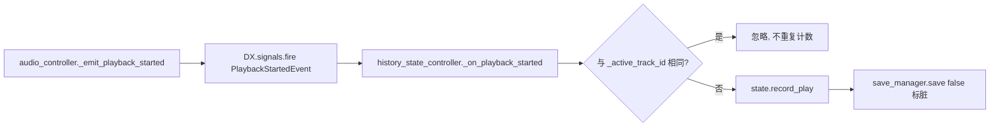

# 播放历史（功能实现文档）

| 项目 | 内容 |
| --- | --- |
| 文档日期 | 2026-11-02 |
| 对应代码版本 | develop @ 77785c0（工作区 2026-11-02） |
| 功能分类 | 应用界面 / 数据存档 |
| 覆盖范围 | 首页功能卡入口、播放历史页（场景 + 视图 + 行）、播放历史控制器、历史统计全局控制器、存档数据模型、翻译与测试 |

> 一句话定位：把用户听过什么、听了多少「记下来并能回看」——每次真正起播累加次数与时间戳，首页「播放历史」卡可以按**最近播放**和**播放最多**两个视角查看，并支持一键重新播放与清空。

## 1. 功能概述

**用户视角**
- 首页第 3 张功能卡（时钟图标）从「该入口暂未接入新页面」的占位提示变成真实页面。
- 页面顶部有清空按钮；标题下方一行统计（共听了几首、累计多少次播放）。
- 页内两个标签页切换排序：
  - **最近播放**：按 `last_played_at` 降序，最近听的排最前；右侧胶囊显示「刚刚 / N 分钟前 / N 小时前 / N 天前 / 具体日期」。
  - **播放最多**：按 `play_count` 降序，次数相同再按最近时间降序；右侧胶囊显示「N 次」。
- 点击任意一行即以当前列表为播放队列起播，并打开播放器页。
- 历史为空时显示与当前标签页对应的空态标题与提示。
- 清空走二次确认弹窗，确认后列表与统计一起归零。

**实现视角**
- 数据层：`MusicPlayHistoryData`（一条统计）+ `MusicAppStateData.play_history`（聚合数组）。
- 记录层：`MusicAppHistoryStateController`（全局，订阅播放事件写入统计）。
- 展示层：`MusicAppHistoryController`（页面控制器，负责排序/文案/播放）+ `MusicAppHistoryView` + `MusicAppHistoryRow`。
- 采用与本地音乐页完全一致的 MVC：页面场景只声明节点，视图管节点与虚拟滚动，控制器管数据与业务。

**不在本期范围**
- 「播放最多」只按总次数排序，没有按时间窗（近 7 天/近 30 天）再筛一层。
- 没有「删除单条历史」，只有整体清空。
- 首页「推荐歌单」「榜单」两张卡仍是占位。

## 2. 功能入口与调用链

**入口清单**

| 入口 | 入口函数 |
| --- | --- |
| 首页第 3 张功能卡 | `assets/scripts/ui/music_app/controllers/music_app_home_controller.gd:87` `open_feature_card(2)` → `:74` `open_history()` |
| 播放起播（自动记录） | `assets/scripts/ui/music_app/controllers/global/music_app_audio_controller.gd:1297` `_emit_playback_started()` |

**打开历史页**

```mermaid
flowchart LR
  A[首页功能卡 index=2] --> B[home_controller.open_history]
  B --> C[show_popup MUSIC_APP_HISTORY]
  C --> D[popup_router: popup.setup(showcase)]
  D --> E[history_view.setup → bind → refresh]
  E --> F[history_controller.get_track_ids]
  F --> G[history_state_controller.get_recent_track_ids]
  G --> H[state.play_history 排序]
```

1. `open_feature_card(index)` 命中 `index == 2`，直接 `open_history()` 并 `return true`（其余 index 行为不变，`index == 3` 仍是本地音乐）。
2. `open_history()` 用 `show_popup(DX_PopupRegistry.PopupId.MUSIC_APP_HISTORY)` 取到弹窗实例；实例非空且实现 `open_page()` 时调用它，触发页面自内向外滑入的入场动画。
3. `DX_PopupRouterController.show_popup()` 内部在 `popup_manager.show()` 后回填 `popup.setup(get_showcase())` —— 这是视图拿到全局控制器的唯一注入点。
4. `MusicAppHistoryView.setup()` 构造页面控制器，`bind()` 接线，`refresh()` 取数并刷新行池。

**起播链路**

`MusicAppHistoryView._play_track()`（`assets/scripts/ui/music_app/views/history/music_app_history_view.gd:192`）→ `MusicAppHistoryController.play_track_list()`（`assets/scripts/ui/music_app/controllers/music_app_history_controller.gd:166`）→ `MusicAppPlaybackController.set_playback_queue(track_ids, slot_index)` → `play_queue_index()` → 打开播放器弹窗。整条链与本地音乐页点歌完全一致，历史页不自己碰音频。

**记录链路**



`_emit_playback_started()` 在 native 链路（wav/mp3/ogg 两条）与 streaming 链路（libmpv 两条）共 4 处调用点都会触发，因此订阅事件即可覆盖全部音源，不需要在每个播放分支里埋统计代码。

## 3. 核心数据结构

**`MusicPlayHistoryData`**（`assets/scripts/save/music/music_play_history_data.gd:1`，`extends DX_JsonObject`）

| 字段 | 类型 | 含义 | 持久化位置 |
| --- | --- | --- | --- |
| `track_id` | `String` | 关联曲目 ID（`TrackData.id`） | `music.play_history[].track_id` |
| `play_count` | `int` | 累计播放次数 | `music.play_history[].play_count` |
| `last_played_at` | `int` | 最近播放时间戳（Unix 秒，0 = 从未播放） | `music.play_history[].last_played_at` |

**为什么单开一个类，不塞进 `TrackData`**（源码注释 `music_play_history_data.gd:6-8`）：`TrackData` 是插件与本地扫描写入的曲目**元数据**，每次插件刷新曲目都会整体重建；统计是**用户行为**，混在一起会让插件刷新把播放次数冲掉。以 `track_id` 为键单独聚合后，即使曲目被移出资料库，统计仍留在存档里，重新加回即可续上。

**`MusicAppStateData` 新增成员**（`assets/scripts/save/music/music_app_state_data.gd`）

| 成员 | 类型 | 位置 | 说明 |
| --- | --- | --- | --- |
| `PLAY_HISTORY_LIMIT` | `const int = 500` | `:12` | 历史条数上限，防止长期使用后存档无限膨胀 |
| `play_history` | `Array[MusicPlayHistoryData]` | `:32` | 聚合数组，最近写入的排在前 |
| `record_play()` | `-> MusicPlayHistoryData` | `:289` | 次数 +1、时间取新、置顶、裁剪 |
| `get_play_history_entry()` | `-> MusicPlayHistoryData` | `:274` | 按 track_id 查单条 |
| `get_play_history_entries()` | `-> Array[MusicPlayHistoryData]` | `:284` | 取全量（页面侧只读用） |
| `get_total_play_count()` | `-> int` | `:308` | 累计次数，可传 `valid_track_ids` 只统计仍在资料库的曲目 |
| `clear_play_history()` | `-> int` | `:319` | 清空并返回被清条数 |
| `_trim_play_history()` | `-> void` | `:324` | 超 500 条时 `resize` 截断尾部 |
| `_normalize_play_history()` | `-> void` | `:330` | 读档时去空/去重/按时间降序/截断 |

**存档格式**：仍然是 `SAVE_VERSION = "0.0.2"`，**不允许升版本**。`dx/runtime/scripts/managers/save/save_data.gd:17` 的 `sanitize_payload()` 用 `str(payload_version) != SAVE_VERSION` 做严格相等比对，版本不符会 `result.erase("music")` 把整个音乐节点（曲目、歌单、下载、历史）全部丢弃。新增字段靠反序列化时缺失即用默认值（`play_history = []`，`_init()` `:81`）实现向后兼容：老存档读出来就是空历史，新存档给老版本读也只是多一个被忽略的键。

**页面控制器状态**（`assets/scripts/ui/music_app/controllers/music_app_history_controller.gd`）

| 成员 | 说明 |
| --- | --- |
| `enum Tab { RECENT, MOST_PLAYED }`（`:8`） | 两个排序视角 |
| `TAB_COUNT = 2`（`:13`） | 供越界夹取与循环切换 |
| `RELATIVE_DAYS_LIMIT = 7`（`:15`） | 相对时间显示上限，超过改显示日期 |
| `_tab`（`:19`） | 当前标签页，默认最近播放 |

## 4. 关键实现

### 4.1 起播去重：为什么同一条事件会来多次

`MusicAppAudioController._sync_audio_state()` 在「暂停后恢复」时也会走一遍起播分支并再次 `_emit_playback_started()`；此外 native 与 streaming 两条链路各自都有 `_emit_playback_started()` 调用点（`music_app_audio_controller.gd:512`、`:540`、`:870`、`:907`）。

如果不做处理，用户暂停再继续一次就会多算一次播放。实现用一个「当前播放中的曲目 ID」做折叠：

```gdscript
func record_playback(track_id: String, played_at: int = -1) -> bool:
    ...
    if normalized_id == _active_track_id:
        return false      # 同一首的续播，不重复计数
```

`_active_track_id` 在 `_on_playback_finished()`（`music_app_history_state_controller.gd:53`）里清空，于是**同一首歌播完再播下一轮能正常计数**（单曲循环场景）；切歌时新 ID 与旧值不同，也会正常计数。

### 4.2 全局记录控制器：为什么用委托而不是继承

`MusicAppHistoryStateController`（`music_app_history_state_controller.gd:1`）位于 `controllers/global/`，与同目录其它全局控制器一致：`extends RefCounted`，构造时接收 `owner`（showcase），内部通过 `_get_base_controller()`（`:27`）临时构造 `MusicAppControllerBase` 来复用存档与弹窗访问，而不是继承基类。好处是全局控制器不携带页面语义，也能在不依赖 showcase 的场景（比如单元测试）里独立构造。

记录写入后调 `save_manager.save(false)`（`:60` 起）——`save(false)` 只是标脏、延迟落盘；整库序列化会卡主线程，所以不能每次起播都 `save(true)`。唯一的例外是 `clear_history()`（`:78`）用 `save(true)` 立即落盘：清空是低频且不可逆的操作，必须当场持久化，否则立刻退出应用会「清了个寂寞」。

### 4.3 排序与去废墟过滤

`get_recent_track_ids()`（`:111`）与 `get_most_played_track_ids()`（`:91`）都先经 `_collect_valid_entries(state)`（`:168`）过滤：

```gdscript
# 只统计仍在资料库里的曲目，避免历史列表出现点开就报错的幽灵行
if state.get_track_by_id(entry.track_id) == null:
    continue
```

排序口径：
- 最近播放：`last_played_at` 降序。
- 播放最多：`play_count` 降序，**平局时按 `last_played_at` 降序**——次数一样时把最近听过的排前面，比按 ID 字典序更有意义。

两者都接受 `limit` 参数（`0` = 不限），页面目前传默认值，由虚拟滚动负责性能。

### 4.4 展示层分工：文案全部由控制器生成

行节点 `MusicAppHistoryRow`（`music_app_history_row.gd:33`）的签名是 `configure(slot_index, title, subtitle, side_text)`——它只负责把四个字符串摆进节点，不做任何格式化。所有「N 次 / 3 天前 / artist」的拼装都在 `MusicAppHistoryController`：

| 方法 | 位置 | 职责 |
| --- | --- | --- |
| `get_row_title()` | `music_app_history_controller.gd:98` | 曲目名，缺失时回落到 `unknown_track` |
| `get_row_subtitle()` | `:107` | 最近播放页 = artist +（次数 > 1 时补次数）；播放最多页 = artist + 上次播放时间 |
| `get_row_side_text()` | `:132` | 最近播放页返回相对时间，播放最多页返回「N 次」 |
| `format_play_count()` | `:141` | `count <= 1` 用 `play_count_one`（英文单数），否则 `play_count` |
| `format_relative_time()` | `:147` | `<60s` 刚刚 / `<1h` N 分钟前 / `<1d` N 小时前 / `<7d` N 天前 / 更早显示 `YYYY-MM-DD` |

这样拆的意图是让行场景可以完全平行复用到别处（后续如果做「最近播放」小卡），换一套文案只改控制器。

`format_relative_time()` 的两个边界：时间戳为 0（从未播放）返回空串，调用方据此隐藏胶囊；`now` 可选传入，测试里固定时间即可断言结果而不受真实时钟影响。

### 4.5 虚拟滚动与「回来就刷新」

列表沿用本地音乐页的节点池方案（`music_app_history_view.gd:130`）：只实例化「视口高度 / ROW_STRIDE + 两侧 overscan」数量的行节点，滚动时只改 `position` 与内容。历史条数上限 500，这个方案足够。

页面还实现了 `_notification(NOTIFICATION_VISIBILITY_CHANGED)`（`:200`）：页面重新可见且已 bind 时自动 `refresh()`。因为播放历史会在用户听歌过程中变化——从历史页点歌进入播放器、听完再返回时，列表必须反映最新次数，否则用户会看到「刚听过的那首还是 1 次」。

## 5. 边界与失败处理

| 场景 | 行为 |
| --- | --- |
| 从未播放过（新存档/老存档升级） | `play_history` 为空数组；页面显示空态，标题与提示按当前标签页区分 |
| 曲目已被移出资料库 | 记录保留在存档中，但列表与统计都按 `get_track_by_id() == null` 过滤，不显示幽灵行 |
| 同一首暂停后恢复 | `_active_track_id` 折叠，不重复计数 |
| 同一首单曲循环播完再播 | 播完事件清空 `_active_track_id`，下一轮正常计数 |
| 空 track_id | `record_play()` 直接返回 `null`，不写入 |
| 时间戳回退（系统时间被调到过去） | `last_played_at` 取 `maxi(旧值, 新值)`，不会被改成更早的时间 |
| 历史超过 500 条 | 写入时 `_trim_play_history()` 截断尾部；读档时 `_normalize_play_history()` 再截一次 |
| 读档数据损坏（重复 ID / 空 ID / null 项） | `_normalize_play_history()` 去重、剔空、按时间重排，保证内存里永远是干净有序的数组 |
| 清空历史 | 二次确认弹窗；确认后 `state.clear_play_history()` + `save(true)` 立即落盘；列表与统计同步归零并刷新 |
| 标签页索引越界 | `set_tab()` 用 `clampi` 夹取，非法值不会污染 `_tab` |
| 页面尚未 setup 就被实例化 | `assets/tests/music_app/music_app_ui_test.gd` 会把 registry 里所有弹窗直接实例化，页面在无 setup 情况下不崩（`@onready` 取节点、不访问控制器） |
| 存档版本 | 保持 `0.0.2` 不变，避免 `sanitize_payload()` 判定不匹配而清空整个音乐节点 |

## 6. 相关测试

`assets/tests/music_app/music_app_history_test.gd`（场景 `music_app_history_test.tscn`）

| 被测对象 | 覆盖点 |
| --- | --- |
| `MusicAppStateData` | 首次记录写入、次数累加、同曲时间取新、`play_history` 头部置顶、按时间降序、超 500 条截断、空 ID 拒绝、`clear_play_history()` 返回值 |
| `MusicAppHistoryStateController` | 最近/最多两种排序、已删除曲目过滤、续播折叠（同 ID 二次 `record_playback` 返回 `false`，`_on_playback_finished(null)` 后可再计数）、`get_play_count`/`get_last_played_at`/`has_history` |
| `MusicAppHistoryController` | 标签页切换与越界夹取、`format_relative_time`（0 → 空串、>7 天 → `YYYY-MM-DD`）、`format_play_count` 单复数、统计文案含数量、两标签页空态文案互不相同 |
| `MusicAppHistoryRow` | `configure()` 后三个 Label 文本正确、`pressed.emit()` 发出对应 slot 索引 |
| 页面场景 | 实例化后 `%HistoryBackButton` / `%HistoryRecentTabButton` / `%HistoryMostPlayedTabButton` / `%HistoryList` 均存在 |

测试不加载 showcase：直接 `MusicAppControllerBase.new().get_app_state()` 命中基类的 `static var _fallback_state` 造数据，因此可在 headless 下稳定跑。

`assets/tests/music_app/music_app_ui_test.gd` 会遍历 `DX_PopupRegistry.POPUP_SCENES` 实例化全部弹窗并在 430×932 与 320×568 两个尺寸下检查溢出——新增的历史页因此自动获得窄屏回归覆盖。

运行方式（macOS，本机）：

```bash
HOME=/tmp/godot-home /Applications/Godot.app/Contents/MacOS/Godot --headless \
  --path <项目根> res://assets/tests/music_app/music_app_history_test.tscn
```

## 7. 相关文件清单

| 路径 | 作用 |
| --- | --- |
| `assets/scripts/save/music/music_play_history_data.gd` | 单条播放统计（track_id / play_count / last_played_at） |
| `assets/scripts/save/music/music_app_state_data.gd` | 新增 `play_history` 字段与 7 个统计 API，接入 `normalize()` |
| `assets/scripts/ui/music_app/controllers/global/music_app_history_state_controller.gd` | 订阅播放事件、写入统计、提供排序查询、清空 |
| `assets/scripts/ui/music_app/controllers/music_app_history_controller.gd` | 页面控制器：标签页、排序、文案格式化、起播、清空确认 |
| `assets/scripts/ui/music_app/views/history/music_app_history_view.gd` | 页面视图：节点接线、虚拟滚动、可见时刷新 |
| `assets/scripts/ui/music_app/views/history/music_app_history_row.gd` | 行视图：只负责摆放 title/subtitle/side 三段文本 |
| `assets/scenes/ui/music_app/history/music_app_history_page.tscn` | 历史页场景 |
| `assets/scenes/ui/music_app/history/history_row.tscn` | 历史行场景 |
| `assets/scripts/constants/music_app_script_paths.gd` | 新增 `HISTORY_PAGE` 及各历史脚本路径常量 |
| `assets/scripts/ui/music_app/music_app_showcase.gd` | 创建 `_history_state_controller`，`_ready` 订阅、`_exit_tree` 退订 |
| `assets/scripts/ui/music_app/controllers/music_app_controller_base.gd` | 新增 `get_history_state_controller()` |
| `assets/scripts/ui/music_app/controllers/music_app_home_controller.gd` | 首页功能卡 index 2 接入 `open_history()` |
| `dx/runtime/scripts/managers/popup/popup_registry.gd` | `PopupId.MUSIC_APP_HISTORY` 与场景注册 |
| `assets/translations/music_app.csv` | 新增 23 条 `music_app.history.*` 文案（en/zh/zh_CN） |
| `assets/tests/music_app/music_app_history_test.gd` / `.tscn` | 历史功能自动化测试 |

## 8. 已知限制与后续

- **只有整体清空，不能删单条**：`clear_play_history()` 一次清全部。若要支持单条删除，需要在 `MusicAppStateData` 加 `remove_play_history(track_id)`，并在行上加长按菜单。
- **播放最多不支持时间窗**：目前是历史总量。做「近 7 天最常听」需要给统计加时间桶或在 `MusicPlayHistoryData` 里保存播放时间列表（会显著增大存档，需权衡）。
- **相对时间的刷新粒度**：列表上的「N 分钟前」只在页面 `refresh()` 时重算，页面常驻不重绘时不会自己走动。目前页面每次重新可见都会刷新，实际影响很小。
- **历史条数上限 500**：超出后最老的统计被截断，用户看不到「很久以前听过一次」的曲目。上限值在 `music_app_state_data.gd:12`，需要时可调。
- **首页仍有 2 张占位卡**：「推荐歌单」与「榜单」点击仍弹「该入口暂未接入新页面」提示。
